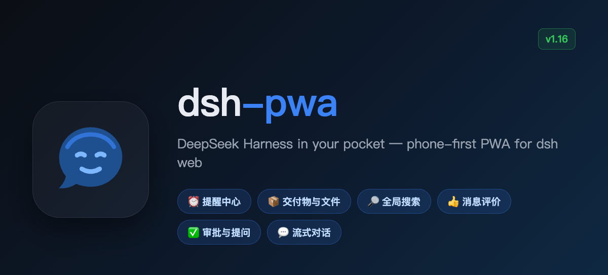
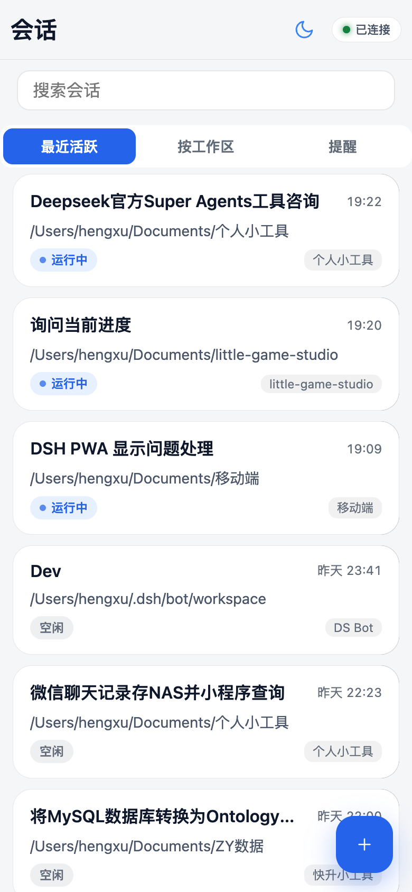
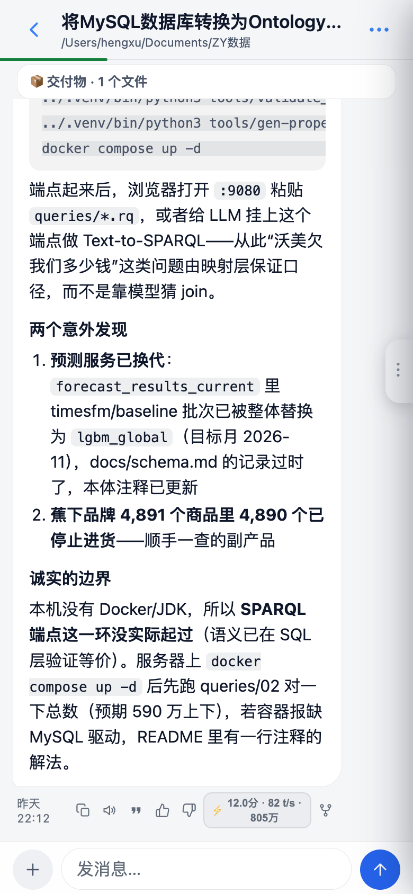

# dsh-pwa

English | [中文](README.zh.md)

**DeepSeek Harness in your pocket.** A phone-first PWA for [DeepSeek Harness](https://github.com/deepseek-ai/deepseek-harness) (`dsh`): it mounts at `/m` on your `dsh web` server — streaming chat, approvals and questions, plus a reminder center, deliverable files with share/AirDrop, full-text session search, and message feedback. No app install: open it in mobile Safari/Chrome → *Add to Home Screen* → full-screen app. iOS and Android.

[](https://www.npmjs.com/package/dsh-pwa)
[](LICENSE)
[](web/manifest.webmanifest)
[](CONTRIBUTING.md)



## Why a PWA instead of a native app?

| | **dsh-pwa** | saya-ch/dsh-mobile | Official web UI over Tailscale |
|---|---|---|---|
| Form | PWA, zero install on the phone | Native Android app + plugin | Desktop-first web UI |
| iOS | ✅ (Safari → Add to Home Screen) | ❌ (Android only) | ✅ (browser) |
| Android | ✅ | ✅ | ✅ |
| Remote access | Inherits `dsh web` (LAN / Tailscale / any reverse proxy) | Built-in: LAN, Tailscale Funnel, cpolar, cloudflared, FRP | Manual `tailscale serve` |
| Push notifications | ❌ (iOS PWA limits) | ✅ (Android system notifications) | ❌ |
| Security model | Same origin + dsh `trusted-host` fence | Cert pinning + device pairing | `trusted-host` fence |
| Maintenance surface | Static files only — speaks the same `/api` as the desktop GUI | Native app + plugin to maintain | None (official UI) |

If you want Android system notifications and certificate-pinned device pairing, check out [saya-ch/dsh-mobile](https://github.com/saya-ch/dsh-mobile). If you want the lightest thing that works on **both** iOS and Android with nothing to install on the phone, you're in the right place.

## Features

- 📋 **Session list** with last-message previews, unread dots, day grouping, workspace grouping, pull-to-refresh, a "needs attention" filter (pending approvals / questions), and rename / fork / archive
- 👥 **Agent Teams & sub-sessions**: a team signal on the Lead's session card, an in-chat team band that opens a read-only roster + task board (with write-scope overlap hints), and member child sessions with lineage, real mode chips (continuable / one-shot) and teammate relay bubbles — no new home tab; one-shot children and continuable children whose direct parent is offline stay read-only
- 🗂 **Session info menu**: the ⋯ sheet shows the session title, Session ID and working path (tap either to copy), with settings grouped into chat / content / manage sections
- 🔎 **Global search**: local title/path filtering plus full-text message search (`session/search`) with highlighted snippets that jump straight to the session
- 💬 **Streaming chat**: optimistic send, per-day dividers, timestamps, code-copy buttons, full-screen image viewer; dual send modes — queue while running, long-press to steer — and queued messages can be edited / steered / removed
- ✅ Approvals & ❓ agent questions as tappable cards (dangerous commands get a red double-confirm)
- 📦 **Deliverables & workspace files**: files the agent `present`s become timeline cards (inline image and video preview, direct text read) with share/AirDrop and open-on-Mac actions; the ⋯ menu browses the whole session workspace with per-turn change hints
- ⏰ **Reminder center**: a third home tab lists every reminder your agents created — humanized schedules, next-fire countdowns, delivery history; delete in place or jump back to the origin session to reschedule
- 👍👎 **Message feedback**: thumbs up/down on any assistant message (tap again to retract), synced live with the desktop feedback store
- 🧠 **Context transparency**: per-turn stats (duration / TTFT / decode speed / tokens), a reasoning drawer, TTS read-aloud, and **compaction markers** — when older context is condensed into a summary, the timeline says so and shows the summary
- 🎯 **Goal management**: banner + action panel (pause / resume / edit / delete) with timeline markers
- 🖼️ Send images from camera / photo library / clipboard paste (auto-compressed to the model's limits)
- 🔐 **In-app re-login**: when auth expires, paste the `dsh web` startup link (or bare token) to mint a fresh login inside the app — no reinstall needed despite iOS home-screen apps having an isolated cookie jar from Safari
- ➕ New sessions with agent-preset picker
- 📳 Haptics, dark/light themes, draft autosave per session, connection-status pill with manual reconnect
- ⚙️ Desktop GUI gets a *Settings → 手机端* entry showing the phone URL + copy button (no typing URLs on a phone keyboard)

The full UX audit trail lives in [docs/AUDIT.md](docs/AUDIT.md) — 152 items, all fixed, each with the root cause.

## Quick start

Prerequisite: desktop `dsh` CLI installed.

**1.** Create (or reuse) a web profile, `~/.dsh/profiles/web/package.json`:

```json
{
  "name": "dsh-profile-web",
  "private": true,
  "dependencies": {
    "dsh-pwa": "latest"
  },
  "dsh": {
    "profile": {
      "bundles": [
        "@deepseek-ai/dsh-base",
        "@deepseek-ai/dsh-web-app",
        "dsh-pwa"
      ]
    }
  }
}
```


**2.** Install and start (add your access domain to the trust fence when the phone connects from outside):

```bash
cd ~/.dsh/profiles/web && npm install
dsh --profile web --host 0.0.0.0 --port 3080 --trusted-host <your-access-domain>
```

**3.** On your phone, open `http://<host>:3080/m/` → *Share → Add to Home Screen* for the full-screen PWA.
   - Same LAN/Wi-Fi: `<host>` is the server's LAN IP.
   - Away from home: use [Tailscale](https://tailscale.com) — add your Tailscale hostname to `--trusted-host` in step 2 (Tailscale must be running on both the server and the phone, logged into the same account), then open `http://<tailscale-hostname>:3080/m/`.

Upgrade later with `npm update dsh-pwa` and a `dsh web` restart. The plugin mounts the static surface plus one authenticated streaming route for large deliverable files; the page speaks DSH's own `/api`, so it moves with your DSH version (developer-preview caveat in the FAQ below).

> **Enabling global search**: the shipped web bundle keeps the full-text index off; set `session-query-sqlite` → `openAt: first-search` in your profile patch. Note: the 0.2.1-rc.x indexer requires a write-free persistence window while building, which conflicts with resident bots (ds-bot heartbeats every 20–40 s) — pick one until upstream relaxes the quiescence check.

## How it works

- The server does exactly one thing: mount `web/` as static files at `/m` (`lib/routes.js`, self-healing if the webServer instance is recreated).
- The page talks directly to DSH's own `/api` — the identical protocol the desktop GUI uses (`POST /api/<ns>/<method>`, `POST /api/respond`, `ws://…/api/events.mux` downstream frames). Zero business-logic duplication.
- Tailscale works out of the box because it reuses the existing `trusted-host` fence.

Iterating on the UI needs no restart: files are re-read per request, just refresh the page.

## Screenshots

| Sessions | Chat |
|---|---|
|  |  |

## Roadmap

Contributor-friendly next steps (from [docs/AUDIT.md](docs/AUDIT.md) §"still needs protocol/server support"):

- [x] Cancel / edit queued messages (`session/updateQueue`)
- [x] Mobile session management: rename / fork / archive
- [ ] Last-message preview + unread counts in `session/list`
- [ ] Web Push: system notifications for approvals & questions while in background (the https prerequisite is now met via `tailscale serve`)
- [ ] Service-worker offline shell

Full list: [docs/ROADMAP.md](docs/ROADMAP.md). Grab one, open a PR — see [CONTRIBUTING.md](CONTRIBUTING.md).

## Contributing

Vanilla JS, no build step, no framework. `web/` is the app, `lib/` is the mount, `client/` injects the desktop settings entry. Details in [CONTRIBUTING.md](CONTRIBUTING.md). PRs welcome — especially the roadmap items above.

## FAQ

**Does it work on iPhone?** Yes — that's the point. Safari → Share → Add to Home Screen.

**Do I install anything on the phone?** No. It's a web page.

**Is it safe to expose?** Same threat model as `dsh web` itself: anyone who can reach the URL (your tailnet / LAN) can drive your agent. Keep it inside a trusted network; don't put it on the public internet.

**Does it work offline?** No — it needs a live connection to your `dsh` server.

**What happens when auth expires?** The page shows a "re-login" dialog: paste the startup link `dsh web` printed on your Mac (or the bare token) and the app mints a fresh login in place — no reinstall required.

**Will a DSH update break it?** The page speaks the same `/api` as the desktop GUI and ships no protocol logic of its own, so it moves with your DSH version. That said, DSH is still in developer preview and its API may change in breaking ways — if that happens, the plugin will need a matching update.

## License

MIT — see [LICENSE](LICENSE).
